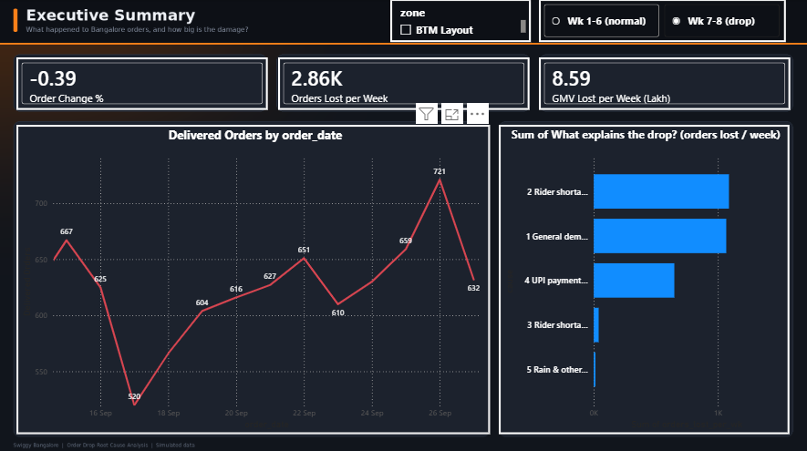
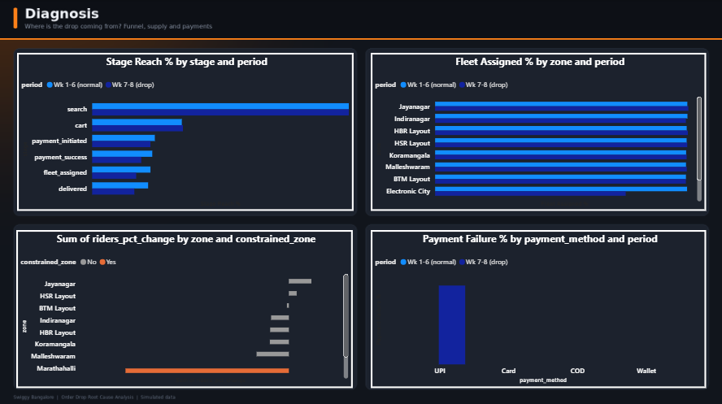
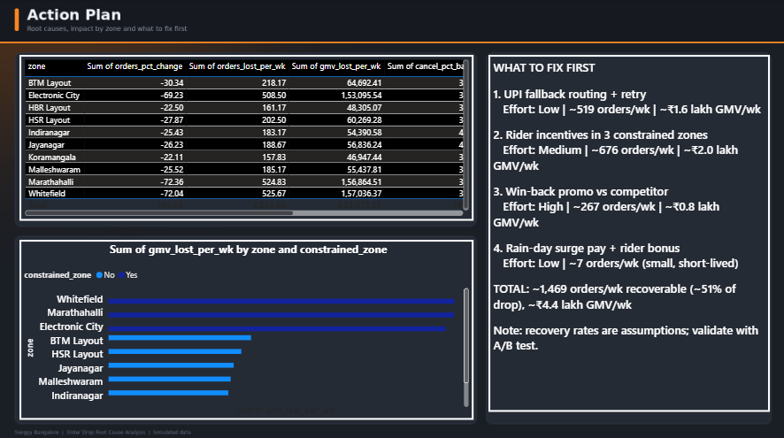

# Swiggy Bangalore: Order Drop Root Cause Analysis

> **Note:** The dataset is **simulated** (real Swiggy data is not public). Four root causes were injected so each analysis step can be validated against known ground truth.

## Business problem
Completed orders in the Bangalore market dropped sharply from week 7. Find the root causes, quantify the revenue impact and recommend prioritized fixes.

## Key findings
- Weekly delivered orders fell **~40%** (about 7,230 to 4,374), roughly **Rs 8.5 lakh GMV lost per week**.
- **Rider shortage** in 3 zones explains ~40% of the drop (riders -31% to -37%, cancellations 3.8% to 14.6%).
- A **platform-wide demand dip** explains ~37%; **UPI payment failures** (0% to 22%) explain ~23%; **rain** is a small, short-lived effect.
- Payment and demand problems are **global**; rider shortage is **local** to 3 zones.
- Fixes sized at ~1,470 orders (~Rs 4.4 lakh GMV) recoverable per week (assumption-based).

## Tech stack
Python (pandas, numpy, scipy, matplotlib) | SQL (SQLite) | Power BI | Git/GitHub

## Project structure
```
swiggy-order-drop-rca/
├── data/raw/            messy generated data (git-ignored)
├── data/processed/      cleaned data
├── db/                  SQLite database (git-ignored)
├── src/                 generate -> clean -> load -> export for Power BI
├── sql/                 10 numbered analysis queries
├── notebooks/           EDA, waterfall attribution, statistical tests
├── dashboard/           Power BI file, data exports, screenshots
├── docs/                insight memo, figures
└── run_pipeline.py      one command, full pipeline
```

## How to run
```bash
python -m venv venv
venv\Scripts\activate          # Windows (Mac/Linux: source venv/bin/activate)
pip install pandas numpy matplotlib scipy ipykernel
python run_pipeline.py
python src/04_export_for_powerbi.py
```
Then open `notebooks/01_eda.ipynb` and `dashboard/` in Power BI.

## Approach
1. **Data prep:** generated ~57K messy orders plus rider and funnel tables; cleaned them (dedupe, standardize 40 zone spellings to 10 and 14 payment variants to 4, fix mixed date formats, handle nulls and outliers) with automated validation checks.
2. **SQL analysis:** week-over-week trend (window functions), payment failure split, zone-level drop, anomaly detection, funnel conversion, rider supply, rain impact, GMV lost.
3. **Python EDA:** exact accounting of the drop (delivered = placed - cancelled - payment failed), waterfall attribution, chi-square and Welch t-tests, counterfactual, sized recommendations.
4. **Dashboard:** 3-page Power BI report (Executive Summary, Diagnosis, Action Plan).

## Dashboard




## Recommendations
See [docs/insight_memo.md](docs/insight_memo.md).

## Lessons learned
- `pd.to_datetime(format="mixed")` silently mis-parsed dd/mm dates (weeks came out negative); fixed by parsing each format explicitly and adding validation asserts.
- A funnel stage was mis-labelled in an early version; caught by sanity-checking a conversion rate that looked too low.

## Limitations
Simulated data; recovery rates are assumptions; real projects would validate with A/B tests.